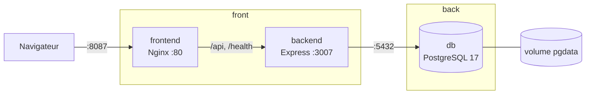

# J1 — Conteneurisation locale

## Architecture locale

- Seul le frontend est exposé sur l'hôte ; la base n'a pas de port publié.
- Nginx sert le build Vite et relaie `/api` et `/health` vers `backend:3007`.

## Images
| Image | Base | Choix |
|---|---|---|
| backend | node:24-alpine | `npm ci --omit=dev`, utilisateur `node`, HEALTHCHECK `/health` |
| frontend | node:24-alpine → nginx:alpine | multi-stage : seuls les fichiers compilés sont dans l'image finale |

## Lancement
```bash
cp .env.example .env   # puis renseigner les valeurs
docker compose up -d --build
```
- Quiz : http://localhost:8087 — Admin : http://localhost:8087/gestion-quiz

## Persistance
Le volume nommé `pgdata` est monté sur `/var/lib/postgresql/data`.
`init.sql` n'est exécuté qu'au premier démarrage (volume vide).
Test : résultat présent → `docker compose down` (sans `-v`) → `up -d` → résultat toujours présent.

## Constats
- Le backend plante sans `RESEND_API_KEY` (le SDK Resend exige une clé) ; il démarre sans base car le pool `pg` se connecte à la demande.
- Nginx plante si l'hôte `backend` n'est pas résolvable au démarrage → `depends_on: service_healthy`.