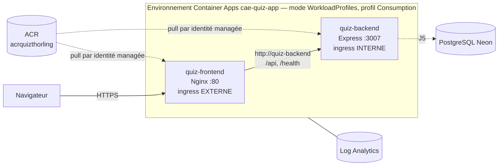

# J4 — Frontend et backend dans Azure Container Apps

## Objectif

Déployer les deux images publiées dans ACR (J3) sur Azure Container Apps : frontend accessible depuis Internet, backend joignable uniquement par le frontend, images tirées d'ACR sans mot de passe, secrets hors du dépôt. Démontrer `GET /health` → HTTP 200 `{"status":"ok"}`.

## Architecture cloud



| Ressource | Nom | Configuration |
|---|---|---|
| Environnement | `cae-quiz-app` | Mode `WorkloadProfiles`, profil `Consumption`, logs vers Log Analytics |
| Container App | `quiz-backend` | Ingress **interne**, port cible 3007, 0,25 vCPU / 0,5 Gi, 0 à 1 réplica |
| Container App | `quiz-frontend` | Ingress **externe** (HTTPS), port cible 80, 0,25 vCPU / 0,5 Gi, 0 à 1 réplica |

Le déploiement est fait par `scripts/deploy.sh` (partie J4), à la suite de la partie J3.

## Utilisation

```bash
# Secrets chargés depuis un fichier non versionné (.env.azure, couvert par .gitignore)
set -a; source .env.azure; set +a

# Déploiement complet (build + push + Container Apps)
./scripts/deploy.sh

# Réutiliser des images déjà présentes dans ACR
SKIP_BUILD=true TAG=<tag> ./scripts/deploy.sh
```

Variables attendues : `ACR_NAME`, `ADMIN_PASSWORD`, `JWT_SECRET`, `RESEND_API_KEY` (valeur factice acceptée), et facultativement `ADMIN_USERNAME`, `FROM_EMAIL`, `DATABASE_URL` (J5).

## Choix techniques

| Choix | Justification |
|---|---|
| Backend en ingress **interne** | Le backend n'est pas exposé sur Internet ; seul le frontend l'appelle. Même cloisonnement qu'en local (réseaux `front` / `back`) |
| Frontend en ingress **externe** | Seul point d'entrée public, en HTTPS (certificat géré par Azure) |
| Identité managée système + rôle AcrPull (`--registry-identity system`) | Les applications tirent les images d'ACR sans identifiant ni mot de passe ; le compte admin ACR reste désactivé |
| Secrets Container Apps + `secretref:` | `RESEND_API_KEY`, `ADMIN_PASSWORD`, `JWT_SECRET` (et `DATABASE_URL` en J5) sont stockés comme secrets de l'application et non en clair dans les variables d'environnement de la révision |
| Secrets fournis au script par variables d'environnement | Aucune valeur sensible dans le dépôt ni dans le script ; `${VAR:?}` fait échouer le script si un secret manque |
| `--allow-insecure` sur l'ingress interne du backend | Autorise le HTTP **interne** Nginx → backend sans redirection HTTPS ; le trafic externe reste en HTTPS via le frontend |
| 0,25 vCPU / 0,5 Gi, `min-replicas 0` | Configuration minimale ; mise en veille sans trafic pour économiser les crédits (contrepartie : démarrage à froid de quelques secondes) |
| Tag d'image = commit Git | La révision indique exactement quel code tourne |

## Adaptation de Nginx au cloud

En local, `nginx.conf` contenait `server backend:3007;` en dur. Sur Container Apps :

- le backend s'appelle `quiz-backend` et est joignable sur le **port 80** de son ingress interne (redirigé vers 3007) ;
- l'ingress Azure **aiguille les requêtes d'après l'en-tête `Host`** ; la configuration d'origine transmettait le `Host` du frontend, la requête n'aurait donc jamais atteint le backend ;
- Nginx résout l'adresse du backend au démarrage et refuse de démarrer s'il ne la trouve pas (constaté en J1).

Solution, sans modification du code applicatif :

- `nginx/nginx.conf` devient `nginx/default.conf.template`, avec `proxy_pass http://${BACKEND_UPSTREAM};` ;
- l'image officielle Nginx remplace la variable au démarrage (dossier `/etc/nginx/templates/`) ;
- `ENV BACKEND_UPSTREAM=backend:3007` dans le Dockerfile : **valeur locale par défaut, Docker Compose inchangé** ;
- sur Azure, le script définit `BACKEND_UPSTREAM=quiz-backend` ;
- suppression de `proxy_set_header Host $host;` : Nginx envoie `Host: quiz-backend`, ce qui permet l'aiguillage par l'ingress.

Une seule image frontend sert donc en local et dans le cloud.

## Démarrage du backend sans base de données

| Situation | Résultat | Explication |
|---|---|---|
| Sans `DATABASE_URL` | Le backend démarre, `/health` répond 200 | Le pool `pg` ne se connecte qu'à la première requête SQL, et `/health` n'interroge pas la base |
| Sans `RESEND_API_KEY` | Le backend **plante au démarrage** | Le SDK Resend lève « Missing API key » dès `new Resend(...)`. Une valeur factice suffit pour démarrer |

`/health` prouve que le serveur répond, **pas** que la base est disponible : la connexion PostgreSQL est validée en J5.

## Incident : environnement « express » créé par défaut

**Symptôme** : à la création du backend, erreur `ExpressRegistrySystemIdentityNotSupported`.

**Diagnostic** : `az containerapp env create` sans option a créé un environnement de type **express** (préversion). D'après la documentation Microsoft, ce mode :

- ne prend pas en charge l'identité managée **système** pour tirer les images d'ACR ;
- n'offre pas de découverte de services entre applications : notre appel `http://quiz-backend` depuis Nginx n'aurait pas fonctionné non plus.

**Correction** : suppression de l'application créée partiellement et de l'environnement, puis recréation avec `--environment-mode WorkloadProfiles` (environnement standard, profil Consumption facturé à l'usage). Le mode est désormais imposé dans `scripts/deploy.sh`, et `--logs-destination log-analytics` est fixé explicitement car sa valeur par défaut est annoncée comme changeante.

## Vérification

```bash
FQDN=$(az containerapp show -n quiz-frontend -g rg-quiz-app --query properties.configuration.ingress.fqdn -o tsv)
curl -i "https://$FQDN/health"            # HTTP 200, {"status":"ok"}

az containerapp list -g rg-quiz-app \
  --query "[].{app:name, externe:properties.configuration.ingress.external, image:properties.template.containers[0].image}" -o table
az containerapp revision list -n quiz-backend  -g rg-quiz-app -o table
az containerapp revision list -n quiz-frontend -g rg-quiz-app -o table
az containerapp logs show -n quiz-backend -g rg-quiz-app --tail 30
```

## Preuves

Dans `preuves/J4/` :

- `curl -i https://<fqdn>/health` : code HTTP 200 et réponse `{"status":"ok"}` ;
- liste des applications (ingress interne/externe, images ACR avec tag) ;
- état des révisions des deux applications ;
- logs du backend (`Server running on port 3007`) ;
- page du quiz affichée depuis l'URL Azure ;
- erreur `ExpressRegistrySystemIdentityNotSupported` et correction (diagnostic de l'incident).

## Limites connues à ce stade

- Sans base de données, l'inscription et l'enregistrement des résultats échouent : c'est l'objet de J5.
- `min-replicas 0` : la première requête après une période d'inactivité peut être plus lente (démarrage à froid).
