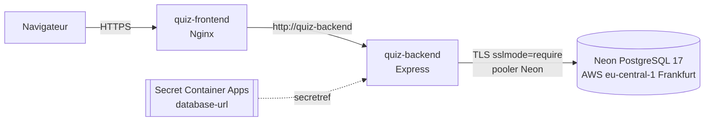

# J5 — PostgreSQL cloud (Neon)

## Objectif

Connecter le backend déployé sur Azure Container Apps à une base PostgreSQL managée externe, par une connexion **chiffrée**, initialiser le schéma, puis démontrer l'enregistrement et la **persistance** d'un utilisateur et d'un résultat de quiz.

PostgreSQL local reste utilisé dans Docker Compose (J1) ; Neon ne sert qu'au déploiement cloud.

## Architecture



| Élément | Choix |
|---|---|
| Fournisseur | Neon (offre gratuite, PostgreSQL managé) |
| Version | PostgreSQL **17**, identique à l'image locale `postgres:17-alpine` |
| Région | AWS **Europe Central 1 (Frankfurt)**, la plus proche de `switzerlandnorth` pour limiter la latence |
| Point d'accès | Hôte **`-pooler`** (pool de connexions géré par Neon) |
| Chiffrement | `sslmode=require` dans la chaîne de connexion |
| Base / rôle | `neondb` / `neondb_owner` |

## Mise en place

### 1. Chaîne de connexion

Récupérée dans la console Neon (bouton **Connect**), puis stockée **uniquement** dans le fichier local non versionné `.env.azure` :

```bash
DATABASE_URL="postgresql://<utilisateur>:<mot-de-passe>@<hôte>-pooler.<région>.aws.neon.tech/neondb?sslmode=require"
```

Le paramètre `channel_binding=require` proposé par Neon a été retiré par précaution : la prise en charge de ce paramètre par le pilote `pg` utilisé par le backend n'a pas été vérifiée, alors que `sslmode=require` suffit à chiffrer la connexion.

### 2. Initialisation du schéma

Les tables ne sont pas créées automatiquement : en local, `init.sql` est exécuté par l'image PostgreSQL au premier démarrage (`docker-entrypoint-initdb.d`), mais rien d'équivalent n'existe pour une base externe. Le script fourni `database/init.sql` est donc appliqué une fois, avec un client `psql` exécuté en conteneur (aucune installation locale) :

```bash
set -a; source .env.azure; set +a
docker run --rm -i postgres:17-alpine psql "$DATABASE_URL" < database/init.sql
docker run --rm postgres:17-alpine psql "$DATABASE_URL" -c "\dt"
```

Résultat : tables `users`, `quiz_results`, `answers` créées.

`init.sql` n'utilise pas `IF NOT EXISTS` : une seconde exécution échoue avec « already exists » sans modifier les données. L'initialisation est donc une opération ponctuelle, documentée ici, et non une étape du déploiement automatique.

### 3. Déploiement

```bash
set -a; source .env.azure; set +a
SKIP_BUILD=true TAG=<tag> ./scripts/deploy.sh
```

Quand `DATABASE_URL` est définie, `scripts/deploy.sh` :

- crée ou met à jour le secret Container Apps `database-url` ;
- définit dans le backend la variable `DATABASE_URL=secretref:database-url` ;
- crée une nouvelle révision du backend.

## Gestion des secrets

| Où | Ce qui s'y trouve |
|---|---|
| Dépôt Git | Aucun secret. `.env` et `.env.azure` sont ignorés (`.gitignore` : `.env.*`) |
| `.env.azure` (poste local) | Valeurs réelles, chargées dans le shell au moment du déploiement |
| Script `deploy.sh` | Aucune valeur, seulement des contrôles `${VAR:?}` qui le font échouer si un secret manque |
| Container Apps | Secret `database-url` ; la variable d'environnement du conteneur n'en contient que la **référence** (`secretref`) |
| Captures / logs | Variables vérifiées avec `${VAR:+OK}`, jamais affichées |

Vérification sans exposer la valeur :

```bash
az containerapp secret list -n quiz-backend -g rg-quiz-app --query "[].name" -o table
az containerapp show -n quiz-backend -g rg-quiz-app \
  --query "properties.template.containers[0].env[?name=='DATABASE_URL']" -o table   # secretRef: database-url
```

### Incident : secrets exposés dans une capture

Une capture d'écran prise pendant la mise en place montrait le contenu de `.env.azure` (mot de passe Neon, `ADMIN_PASSWORD`, `JWT_SECRET`). Mesures prises :

- réinitialisation du mot de passe du rôle `neondb_owner` dans Neon et mise à jour de `DATABASE_URL` ;
- régénération de `ADMIN_PASSWORD` et `JWT_SECRET` (`openssl rand -hex`) ;
- redéploiement pour mettre à jour les secrets Container Apps ;
- capture supprimée ; les captures suivantes sont prises fichier `.env.azure` fermé.

Règle retenue : **un secret affiché est un secret à changer.**

## Démonstration fonctionnelle

1. Inscription et quiz complet depuis l'URL publique du frontend Azure.
2. Résultat visible dans l'espace d'administration (`/gestion-quiz`).
3. Vérification directe dans Neon :

```bash
docker run --rm postgres:17-alpine psql "$DATABASE_URL" -c \
  "SELECT u.firstname, qr.score, qr.completed_at FROM quiz_results qr JOIN users u ON u.id = qr.user_id;"
```

## Persistance

Les données sont stockées dans Neon, indépendamment du cycle de vie des conteneurs. Test :

```bash
REV=$(az containerapp revision list -n quiz-backend -g rg-quiz-app --query "[?properties.active].name | [0]" -o tsv)
az containerapp revision restart -n quiz-backend -g rg-quiz-app --revision "$REV"
# puis nouvelle requête SQL : le résultat est toujours présent
```

Le résultat enregistré est toujours présent après le redémarrage de la révision.

## Points d'attention

- **Mise en veille de Neon** : la base gratuite se suspend après une période d'inactivité. Le backend n'attend que 2 secondes l'ouverture d'une connexion (`connectionTimeoutMillis: 2000` dans `server.js`) : la première requête après une longue inactivité peut échouer, la suivante réussit. Ce paramètre relève du code applicatif, non modifié dans le cadre de l'évaluation.
- **Validation du certificat** : la connexion est chiffrée ; le certificat présenté par Neon est émis par une autorité publique reconnue.
- **Évolution du schéma** : sans outil de migration dans le projet, toute modification de schéma devra être appliquée manuellement, comme l'initialisation.

## Preuves

Dans `preuves/J5/` (aucune chaîne de connexion visible) :

- projet Neon : région et version ;
- `\dt` : 3 tables ;
- quiz terminé depuis l'URL Azure et résultat dans `/gestion-quiz` ;
- requête SQL avant et après redémarrage de la révision ;
- liste des secrets du backend (noms uniquement) et `DATABASE_URL` en `secretRef`.
