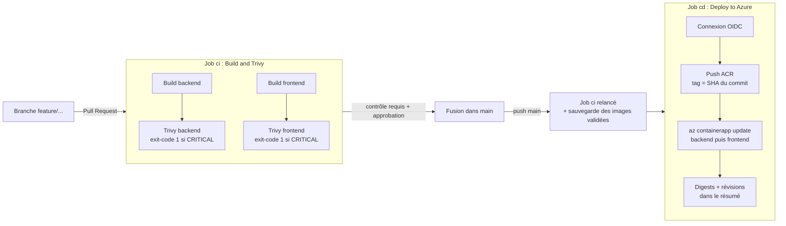

# J6 — CI/CD : intégration et déploiement continus

## Objectif

Automatiser la chaîne de livraison de Quiz App avec GitHub Actions, en deux validations distinctes :

- **J6-A (CI)** : à chaque Pull Request vers `main`, construire les images backend et frontend, les scanner avec Trivy et **bloquer la fusion** si une vulnérabilité CRITICAL est détectée.
- **J6-B (CD)** : après fusion dans `main`, publier dans ACR les images validées par la CI et mettre à jour automatiquement les Container Apps.

## Architecture du pipeline

Fichier : `.github/workflows/pipeline.yml`

| Déclencheur | Job `ci` | Job `cd` |
|---|---|---|
| Pull Request vers `main` | Oui | **Non** (pas de déploiement des PR) |
| Push sur `main` (fusion) | Oui | Oui, si `ci` réussit |
| Lancement manuel | Oui | Non |

## Choix techniques

| Choix | Justification |
|---|---|
| Trivy `--exit-code 1 --severity CRITICAL` | Le job échoue dès qu'une vulnérabilité critique est trouvée. Aucun `continue-on-error` : le contrôle ne peut pas être ignoré |
| Version de Trivy fixée (`aquasec/trivy:0.70.0`) | Résultats reproductibles ; pas de changement d'outil non maîtrisé avec `latest` |
| Scan du frontend même si le backend échoue (`!cancelled()`) | On obtient les deux rapports en une exécution ; le job reste en échec |
| Rapports Trivy publiés en artifact (`if: always()`) | Preuve conservée 30 jours, y compris en cas d'échec |
| Images sauvegardées par la CI puis chargées par le CD | Le CD publie **exactement** les images scannées, sans reconstruction |
| Tags = SHA du commit | Chaque image est traçable jusqu'au commit ; pas de dépendance à `latest` |
| OIDC (`azure/login@v2`) | Aucun mot de passe ni secret long terme stocké dans GitHub |
| `id-token: write` uniquement sur le job `cd` | Moindre privilège : le code d'une PR ne peut pas obtenir de jeton Azure |
| `concurrency` sur le CD | Deux déploiements ne peuvent pas se chevaucher |
| Digests et révisions dans le résumé du workflow | Preuve directement lisible dans l'exécution GitHub Actions |

### Secrets et variables GitHub

Configurés dans **Settings → Secrets and variables → Actions** du fork (valeurs non reproduites ici).

| Type | Nom | Rôle |
|---|---|---|
| Secret | `AZURE_CLIENT_ID` | Identifiant de l'identité de service utilisée par le pipeline |
| Secret | `AZURE_TENANT_ID` | Tenant Azure |
| Secret | `AZURE_SUBSCRIPTION_ID` | Abonnement Azure |
| Variable | `AZURE_RESOURCE_GROUP` | Groupe de ressources |
| Variable | `ACR_NAME` | Nom du registre ACR |
| Variable | `BACKEND_APP` | `quiz-backend` |
| Variable | `FRONTEND_APP` | `quiz-frontend` |

L'identité de service dispose uniquement des droits nécessaires : *AcrPush* sur le registre et *Contributor* limité au groupe de ressources. Sa *federated credential* n'accepte que les jetons émis pour la branche `main` du fork.

## Protection de la branche `main`

Configurée dans **Settings → Branches** (ou **Rules → Rulesets**) du fork :

| Règle | État |
|---|---|
| Pull Request obligatoire avant fusion | … |
| Approbation requise | … |
| Contrôle requis : `Build and Trivy` | … |
| Suppression et force push interdits | … |
| Test de push direct sur `main` refusé | … |

> Restrictions éventuelles liées au plan GitHub : …

## Démonstration

### 1. Contrôle en échec (démonstration contrôlée)

Pour prouver le blocage sans publier d'image vulnérable, le seuil du scan a été abaissé temporairement à `--severity CRITICAL,HIGH` dans une branche de test. La CI échoue, la fusion est bloquée, et aucune image n'est publiée ni déployée.

- PR : …
- Exécution en échec : …
- Capture : `preuves/J6/ci-echec.png`

Le seuil a ensuite été remis à `CRITICAL`.

### 2. Scénario nominal : modification d'une question

Une question existante de `questions_docker.js` a été modifiée dans la branche `feature/…`.

| Étape | Preuve |
|---|---|
| Pull Request vers `main` du fork | … |
| CI réussie (Build and Trivy) | … , `preuves/J6/ci-ok.png` |
| Rapports Trivy | Artifact `rapports-trivy-<sha>` |
| Approbation | `preuves/J6/approbation.png` |
| Fusion dans `main` | … |
| Exécution du CD | … , `preuves/J6/cd-ok.png` |

### 3. Images publiées et révisions

| Image | Tag | Digest |
|---|---|---|
| `quiz-backend` | … | `sha256:…` |
| `quiz-frontend` | … | `sha256:…` |

Nouvelles révisions Container Apps : `preuves/J6/revisions.png`

Question modifiée visible dans Quiz App : `preuves/J6/question-modifiee.png`

## Limites et points d'attention

- Le scan bloque sur CRITICAL uniquement : des vulnérabilités HIGH peuvent subsister. Elles sont visibles dans les rapports et doivent être suivies.
- La base de vulnérabilités Trivy évolue : une image validée aujourd'hui peut être bloquée demain sans modification du code.
- La CI est rejouée après la fusion sur `main` : c'est cette exécution, et non celle de la PR, qui produit les images déployées. Elles sont donc scannées une seconde fois juste avant publication.
- Le pipeline prouve la construction, la publication et la création des révisions ; le bon fonctionnement applicatif dépend aussi de la base PostgreSQL (J5).
